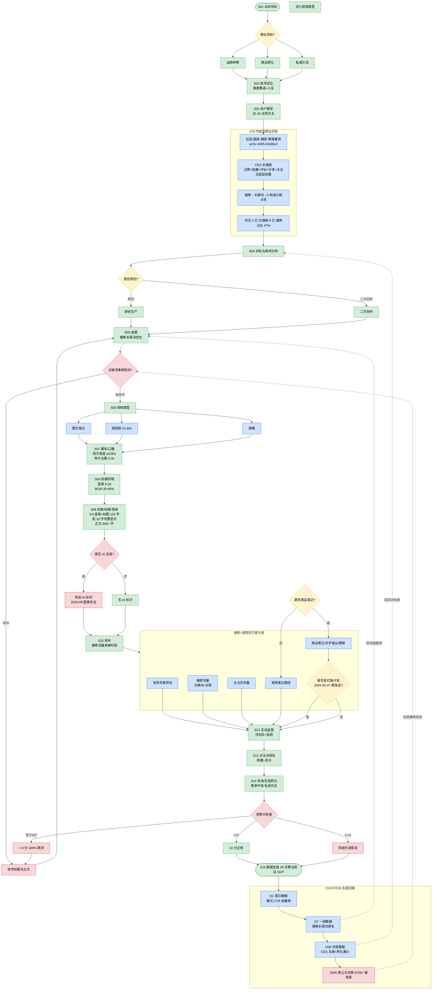
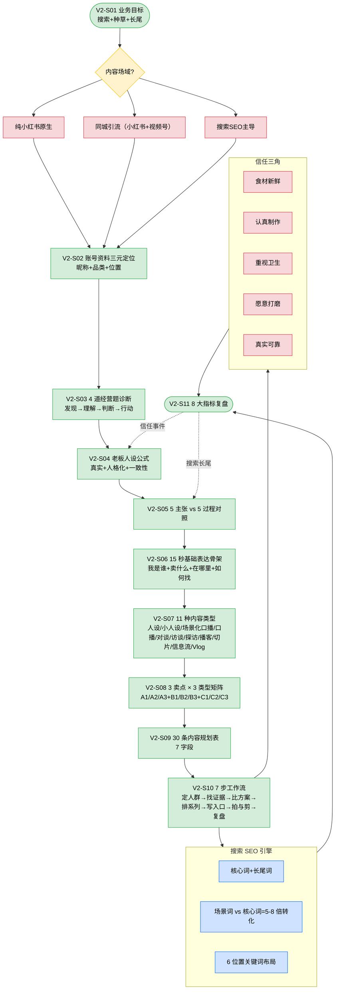

# 小红书完整运营流程图

> 检索截止：2026-10-02｜基于简报 1（小红书）+ 本机知识库整合

## 图

## 图例

- 绿色 = 通用运营环节（S01-S15 中小红书标准执行节点）
- 蓝色 = 平台特有机制（小红书算法、流量入口、合规后置动作等平台专属环节）
- 黄色 = 关键决策点（原创/二创、商品笔记、红猫计划等业务分叉）
- 红色 = 合规风险点（关键词堆砌、AI 标识、信誉分、黑公关案例）

## 节点说明（按顺序列出每个节点的关键操作）

1. **S01 业务目标**：在品牌种草/商品转化/私域引流三目标中选择主导；小红书擅长种草长尾，转化偏弱。
2. **S02 账号定位**：垂直赛道+人设包装；女性 25-35 岁为主人群决定审美/情感向定位优先。
3. **S03 用户需求**：通过搜索词清单和评论数据反推需求；月活 4 亿，日搜索 8 亿，搜索占比 47%。
4. **S04 对标与素材分析**：抓取头部笔记拆解 3:4 封面+≤20 字标题+600+ 字正文三大爆款规律。
5. **S05 选题**：从搜索长尾词切入；命中关键词堆砌检测则回炉改写（合规优先）。
6. **S06 视频类型**：图文 / 短视频 15-60s / 直播三选一；是否商品笔记决定后续分发路径。
7. **S07 脚本/口播**：钩子密度 ≥5/30s、钩子位置 0-3s；正文 600+ 字是爆款标配。
8. **S08 拍摄剪辑**：竖屏 9:16 优先；BGM 占比 30-40%；完播率 ≥50% 视为 A 级。
9. **S09 封面/标题/首帧**：3:4 竖版封面、标题 ≤20 字（前 18 字必须完整显示）、正文 600+ 字。
10. **S10 发布**：AI 生成内容必须按 2025-09 国家办法添加 AI 标识。
11. **S11 分发**：发现页推荐 + 搜索 + 关注三大入口；商品笔记可选红猫计划跳淘宝（2025-05-07 启动）。
12. **S12 互动运营**：评论区回复速度、私信关键词触发、收藏引导；小红书核心动作是收藏+搜索。
13. **S13 关注与信任**：通过系列化内容建立账号信任，提升关注转化率。
14. **S14 咨询/交易转化**：客单中低（参考抖音 130 元基准，小红书略低）；以私信和评论区为主。
15. **S15 数据复盘**：执行 D1/D7/D30 算法验证 SOP，三阶段数据回流对标库与选题库。

## 关键判断分支说明

### 分支 1：原创判断（D1 节点）

- 触发条件：S04 对标分析完成后，确认内容生产方式
- 平台差异：小红书原创内容权重高，二创需注意搬运检测
- 推荐动作：原创 + 二次混剪结合，原创占比 ≥60% 保账号安全

### 分支 2：商品笔记判断（T4 节点）

- 触发条件：内容主题含商品或服务推广意图
- 平台差异：商品笔记 / 买手笔记 / 晒单 / 常规四类需要选择正确类目
- 推荐动作：商品笔记必须挂商品链接并完成商家资质认证；否则走常规笔记路径

### 分支 3：红猫计划判断（X4 节点）

- 触发条件：商品笔记已发布、淘宝店铺已开通
- 平台差异：红猫计划为 2025-05-07 启动的 B 端跳淘宝通道
- 推荐动作：高客单或品牌商品优先走红猫；低客单或单纯种草走常规路径

### 分支 4：AI 标识判断（AI 节点）

- 触发条件：内容含 AI 生成图、AI 文案、AI 配音、AI 剪辑任一环节
- 平台差异：2025-09 国家办法、2026-02/03/04 三次公告持续收紧
- 推荐动作：所有 AI 环节必须显式标注；未标注触发限流甚至下架

### 分支 5：信誉分检查（CR 节点）

- 触发条件：每次内容生产前/发布前/转化前
- 平台差异：初始 10 分，扣至 8 分以下 100% 流量限制
- 推荐动作：维持 ≥9 分；被扣分立即停更整改

## 复盘回路说明

**D1 首日复盘**：检查曝光量、点击率、收藏率三项基础数据；判断标题封面是否有效，CTR < 3% 立即调整。

**D7 一周复盘**：检查搜索长尾词排名进入情况；CES 五维中"收藏"权重最高，需重点对比收藏率。

**D30 月度复盘**：跑完整转化漏斗（曝光→点击→互动→收藏→关注→私信→成交）；结合 2026-09-24 黑公关封禁 8700+ 案例库做合规自查。

**合规回流**：复盘中发现的违规点回流至 S05 关键词堆砌检测节点，更新关键词黑名单。

---

## V2 增量分支（2026-10-02 基于 5 份新资料补充）

> **新增依据**：同城引流 PDF + 卖点可视化批量生产 PDF + 11 种内容类型 PDF + 抖音双平台核心逻辑 PDF
> **重点深挖**：4 道经营题诊断 / 5 主张 vs 5 过程 / 15 秒基础骨架 / 11 种内容类型 / 30 条规划表
> **增量公式**：V2-NEW 公式 72 组（已写入 小红书独立资产库_v1.xlsx）

### V2 子图：小红书搜索+种草+同城 3 模式融合

### V2 关键决策分支

- **V2-1 内容场域判断**（V2_G）：纯小红书 / 同城引流 / 搜索 SEO → 不同策略
- **V2-2 账号资料三元定位**（V2_S02）：昵称+品类+位置（搜索权重最高字段组合）
- **V2-3 4 道经营题**（V2_S03）：每条内容同步回答 4 问题（在哪？/卖什么？/凭什么信？/怎么找？）
- **V2-4 5 主张 vs 5 过程对照**（V2_S05）：食材新鲜→采购时间等
- **V2-5 15 秒骨架**（V2_S06）：我是谁+卖什么+在哪里+如何找
- **V2-6 3 卖点 × 3 类型矩阵**（V2_S08）：A1/A2/A3+B1/B2/B3+C1/C2/C3 = 9 格
- **V2-7 30 条内容规划表**（V2_S09）：7 字段（受众/类型/视角/场景/入口/证据/复盘）
- **V2-8 7 步工作流**（V2_S10）：定人群→找证据→比方案→排系列→写入口→拍与剪→复盘
- **V2-9 搜索 SEO 引擎**（V2_SEARCH）：核心词+长尾词 / 场景词=5-8 倍 / 6 位置布局
- **V2-10 信任三角**（V2_TRUST）：食材新鲜+认真制作+重视卫生+愿意打磨+真实可靠

### V2 小红书搜索运营核心数据

- 搜索流量占比 47%（行业经验）
- 场景词转化是核心词 5-8 倍
- 长尾词转化高 3-5 倍
- 推荐流量生命周期 3-7 天；搜索流量生命周期 6 个月+
- 月活 4 亿，日搜索 8 亿，每月 2 亿用户寻求购买建议

### V2 小红书 6 项发布检查清单

- 唯一主 CTA（评论关键词/拍定位/关注账号，三选一不混用）
- 无利诱/胁迫赞关评转
- 无极限词（❌"最/第一/100%/必爆"）
- 事实主张（小红书 2026-02-10 三品一械达人广告禁令）
- 同城三件套（位置+话题+同城标签齐全）
- 挂载组件（POI/团购/企微/公众号入口）

---

**V2 增量公式映射清单**：详细 V2-NEW 公式 72 组（按 N01-N09 子表）已写入 小红书独立资产库_v1.xlsx。
