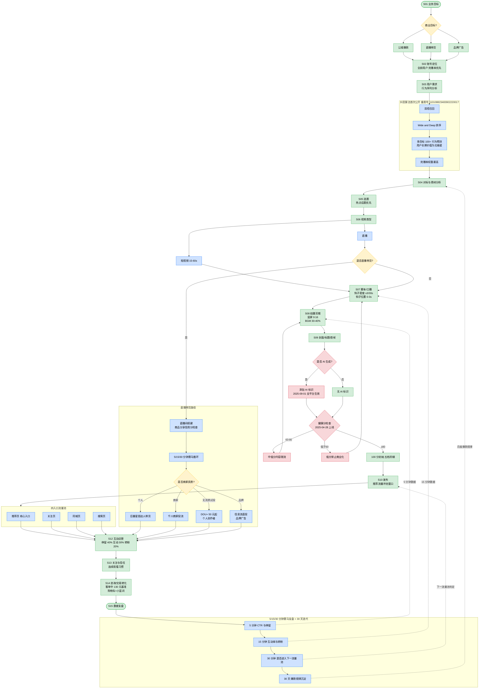

# 抖音完整运营流程图

> 检索截止：2026-10-02｜基于简报 3（抖音算法首次公开）整合

## 图

## 图例

- 绿色 = 通用运营环节（S01-S15 中抖音标准执行节点）
- 蓝色 = 平台特有机制（双塔召回/Wide\&Deep/多目标预测、四入口流量池、5/15/30 分钟赛马等抖音专属）
- 黄色 = 关键决策点（直播带货分叉、商业目标分叉、商家资质判断）
- 红色 = 合规风险点（AI 标识、健康分阈值、商品分享信用分）

## 节点说明（按顺序列出每个节点的关键操作）

1. **S01 业务目标**：公域爆款 / 直播带货 / 品牌广告三目标主导；抖音擅长公域流量冲池。
2. **S02 账号定位**：全龄用户覆盖，定位语言需匹配完播率优先的算法偏好。
3. **S03 用户需求**：通过行为序列分析（不是关键词），抖音以行为数据反推需求。
4. **S04 对标与素材分析**：双塔召回原理要求素材库覆盖多行为标签；爆款标准=百万播放。
5. **S05 选题**：热点话题优先；多目标预测决定选题必须有足够的行为触发潜力。
6. **S06 视频类型**：短视频 15-60s 或直播；直播带货需走 L1-L7 子流程。
7. **S07 脚本/口播**：钩子密度 ≥3/30s、钩子位置 0-3s；完播率 ≥35% 为进热门门槛。
8. **S08 拍摄剪辑**：竖屏 9:16 强制；BGM 占比 30-40%；停留时长是核心指标。
9. **S09 封面/标题/首帧**：首帧决定 3 秒跳出率，需与脚本钩子对齐。
10. **S10 发布**：AI 内容必须按 2025-09-01 全平台 AI 标识办法标注。
11. **S11 分发**：推荐页（核心）+ 关注 + 同城 + 搜索四入口；进入流量池后跑赛马。
12. **S12 互动运营**：停留 40% > 互动 30% > 转粉 20% > 举报 10% 的权重体系决定动作优先级。
13. **S13 关注与信任**：通过连续发布培养用户连续观看习惯，提升账号粉丝粘性。
14. **S14 咨询/交易转化**：客单中位 130 元基准；购物车 + 小蓝词 + 直播间三路径。
15. **S15 数据复盘**：5/15/30 分钟赛马循环 + 30 天迭代；CTR、互动率、是否进入下一流量池是核心判定。

## 关键判断分支说明

### 分支 1：直播带货分叉（T3 节点）

- 触发条件：内容主题涉及商品推广或服务预约
- 平台差异：直播带货需独立子流程，依赖商品分享信用分
- 推荐动作：开播前完成商家/达人资质审核；新手建议先 DOU+ 50 元起试投

### 分支 2：商家资质分叉（L3 节点）

- 触发条件：直播间开通后选择投流工具
- 平台差异：巨量星图（达人）/ 千川（商家）/ DOU+（个人）/ 信息流直投（品牌）四套体系
- 推荐动作：根据账号主体资质选择工具；个人无千川权限需先完成企业认证

### 分支 3：AI 标识判断（AI 节点）

- 触发条件：内容含 AI 生成图、AI 文案、AI 配音、AI 剪辑任一环节
- 平台差异：2025-09-01 全平台强制；未标注直接限流
- 推荐动作：所有 AI 元素必须显式标注；AIGC 视频需走专门审核通道

### 分支 4：健康分阈值判断（HS 节点）

- 触发条件：每次内容生产前/发布前
- 平台差异：2025-04-28 上线，100 分初始，五档阶梯
- 推荐动作：维持 ≥90 分；内容方向含高危关键词立即降权或下架

## 复盘回路说明

**5 分钟赛马**：检查 CTR 与停留时长；CTR < 5% 或停留 < 25% 判定首帧与标题失败，立即调整重发。

**15 分钟赛马**：检查互动率与转粉率；互动率 < 3% 判定钩子未起作用，回流至 S07 脚本节点。

**30 分钟赛马**：检查是否进入下一流量池；进入失败则放弃单条，转向下一选题。

**30 天迭代**：月度沉淀爆款规律（钩子模板、节奏模板、封面模板），回流至 S04 对标库。

**健康分回流**：健康分扣分事件回流至 S07/S08 节点，更新高危关键词与画面黑名单。

---

## V2 增量分支（2026-10-02 基于 5 份新资料补充）

> **新增依据**：抖音双平台核心逻辑 PDF + 卖点可视化批量生产 PDF + 11 种内容类型 PDF  
> **重点深挖**：4 项生产原则 / 4 类画面功能地图 / 3 卖点 × 3 类型矩阵 / 前-中-后成片结构 / 11 种内容类型  
> **增量公式**：V2-NEW 公式 91 组（已写入 抖音独立资产库_v1.xlsx）

### V2 子图：抖音算法链路 5 步 + 4 项生产原则 + 11 种内容类型

```mermaid
flowchart LR
    V2_S01([V2-S01 业务目标<br/>爆款+GMV+复购]):::green
    V2_S02[V2-S02 抖音 4 项生产原则<br/>有效+有依据+批量+多样性]:::green
    V2_S03[V2-S03 抖音算法链路 5 步<br/>进入池→召回→排序→调整→反馈]:::green

    subgraph V2_ALG [算法精细版]
        V2_A1[1 进入内容池<br/>初评估]:::blue
        V2_A2[2 召回候选<br/>双塔向量]:::blue
        V2_A3[3 排序打分<br/>多目标 100+]:::blue
        V2_A4[4 调整列表<br/>打散/多样性]:::blue
        V2_A5[5 反馈学习<br/>真实行为]:::blue
    end

    V2_S04[V2-S04 2026 优质内容大模型<br/>获得感+惊喜感+表达力+感染力]:::green
    V2_S05[V2-S05 11 种内容类型<br/>人设/小人设/场景化口播/口播/对谈/访谈/探访/播客/切片/信息流/Vlog]:::green

    V2_S06[V2-S06 3 卖点 × 3 类型矩阵<br/>A1/A2/A3 + B1/B2/B3 + C1/C2/C3]:::green
    V2_S07[V2-S07 4 类画面功能地图<br/>兴趣/需求/产品信息/效果展示]:::green

    V2_S08[V2-S08 前-中-后成片结构<br/>前-吸引+中-产品-后-转化]:::green
    V2_S09[V2-S09 抖音 3 案例拆解<br/>发品+食品+定妆 完整情境-动作-结果链]:::green

    V2_S01 --> V2_S02 --> V2_S03
    V2_S03 --> V2_ALG
    V2_ALG --> V2_S04 --> V2_S05
    V2_S05 --> V2_S06 --> V2_S07 --> V2_S08 --> V2_S09

    classDef green fill:#d4edda,stroke:#28a745,color:#000
    classDef blue fill:#cfe2ff,stroke:#0d6efd,color:#000
    classDef yellow fill:#fff3cd,stroke:#ffc107,color:#000
```

### V2 关键决策分支

- **分支 V2-1：双平台底层逻辑对比**（V2_S03）：抖音=大众池子（9 年义务教育类比）/ 视频号=阶层类比 → 内容选择策略差异
- **分支 V2-2：抖音反对观点驳斥**（V2_S04）：驳"只适合娱乐"+驳"算法核心权重核心误读"+驳"专业资历自动=传播效果"
- **分支 V2-3：抖音算法 5 步精细版**（V2_ALG）：5 步 → 进入内容池→召回→排序→调整→反馈（比原"召回+排序+重排"更精细）
- **分支 V2-4：3 卖点 × 3 类型矩阵**（V2_S06）：9 格画面任务（A1/A2/A3 + B1/B2/B3 + C1/C2/C3）
- **分支 V2-5：4 类画面色标**（V2_S07）：黄色=兴趣吸引 / 红色=需求时刻 / 绿色=产品信息 / 粉紫色=效果展示
- **分支 V2-6：前-中-后结构**（V2_S08）：前（吸引+痛点+剧情+故事）→ 中（产品引出+使用+效果）→ 后（价格+产品+效果导向）
- **分支 V2-7：11 种内容类型**（V2_S05）：4 类（人设/小人设/场景化口播/口播）+ 4 类（对谈/访谈/探访/播客）+ 3 类（切片/信息流/Vlog）

### V2 抖音 3 案例完整拆解

- **发品**（工作场景）：职业故事（赶飞机）→ 塌发（当前问题）→ 喷涂 + 揉搓（使用过程）→ 三七发缝 + 蓬松（效果）
- **食品**（居家场景）：居家 + 进食 + 朋友聊天（需求时刻）→ 撕咬 + 脱骨（质地）→ 居家联想（素材）
- **定妆**（重要场合）：妆容 + 服装（持妆需求）→ 喷雾细腻 + 摩擦（使用过程）→ 服帖 + 摩擦后（效果）

### V2 抖音 6 项发布检查清单（V2-NEW）

- 唯一主 CTA（评论关键词/拍定位/关注账号，三选一不混用）
- 无利诱/胁迫赞关评转（✅ 自然引导，❌ "点赞抽奖送 X"）
- 无极限词（❌ "最/第一/100%/必爆"）
- 事实主张（"现炒不预制"必须有店内依据）
- 同城三件套（定位 + 话题 + 同城标签齐全）
- 挂载组件（POI/团购/企微/公众号入口）

---

**V2 增量公式映射清单**：详细 V2-NEW 公式 91 组（按 N01-N09 子表）已写入 抖音独立资产库_v1.xlsx。
