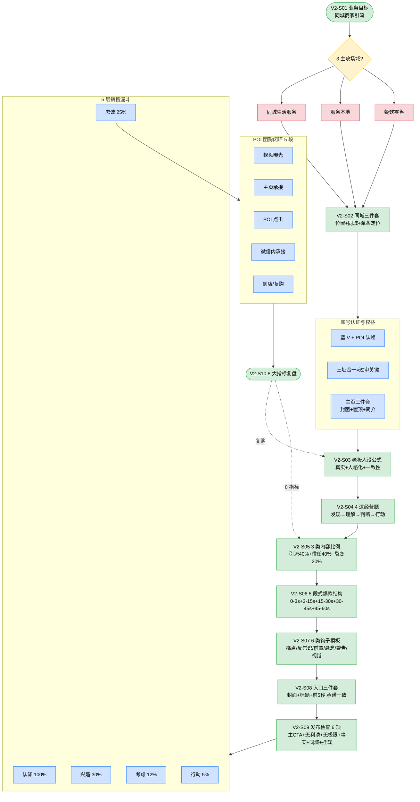

# 视频号完整运营流程图

> 检索截止：2026-10-02｜基于简报 2（视频号双引擎）+ 本机知识库整合

## 图

```mermaid
flowchart TD
    %% ========== 起点 ==========
    S01([S01 业务目标]):::green
    G{商业目标?}:::yellow
    G1[高客单转化]:::green
    G2[私域沉淀]:::green
    G3[微信生态联动]:::green

    S02[S02 账号定位<br/>四大认证体系]:::green
    subgraph AUTH [认证与权益阶梯]
        AC1[企业认证]:::blue
        AC2[职业认证]:::blue
        AC3[兴趣认证 1000 粉门槛]:::blue
        AC4[金V 认证 1 万粉门槛]:::blue
        LV0[0 粉初始权益]:::blue
        LV1[100 粉解锁]:::blue
        LV2[1000 粉解锁]:::blue
        LV3[1 万粉解锁]:::blue
    end

    S03[S03 用户需求<br/>25+ 占 97.7%]:::green

    %% ========== 双引擎 ==========
    subgraph ALG [双引擎机制 B 级 行业共识]
        A1[社交推荐 55%]:::blue
        A2[算法推荐 45%]:::blue
        A3[官方未确认 行业经验值]:::blue
    end

    S04[S04 对标与素材分析]:::green
    S05[S05 选题<br/>社交话题优先]:::green

    %% ========== 行业公约判断 ==========
    IND{内容领域?}:::yellow
    IND_FIN[金融领域]:::red
    IND_LAW[法律领域]:::red
    IND_HEA[健康科普]:::red
    IND_NOR[常规内容]:::green

    S06[S06 视频类型<br/>30-90s 优先]:::green
    T1[短视频 30-90s]:::blue
    T2[直播]:::blue
    T3[长视频]:::blue

    S07[S07 脚本/口播<br/>钩子密度 ≥4/30s<br/>钩子位置 0-5s]:::green
    S08[S08 拍摄剪辑<br/>横屏 16:9 优先<br/>BGM ≤30%]:::green
    S09[S09 封面/标题/首帧<br/>完播率 ≥40% 为 A]:::green

    %% ========== AI 标识合规 ==========
    AI{是否 AI 生成?}:::red
    AI_Y[添加 AI 标识<br/>2025-09-01 强制]:::red
    AI_N[无 AI 标识]:::green

    %% ========== 发布 ==========
    S10[S10 发布<br/>朋友点赞窗口期]:::green

    %% ========== 五入口流量 ==========
    subgraph FLOW [五入口流量]
        F1[关注页]:::blue
        F2[朋友点赞页 核心]:::blue
        F3[推荐页]:::blue
        F4[附近页]:::blue
        F5[搜一搜]:::blue
    end

    %% ========== 私域撬公域 ==========
    PRI{私域触发?}:::yellow
    subgraph PRIVATE [私域沉淀闭环]
        P1[朋友圈扩散]:::blue
        P2[公众号文章联动]:::blue
        P3[企业微信 1v1 触达]:::blue
        P4[小程序商城]:::blue
        P5[微信小店<br/>2024-08-25 全域交易升级]:::blue
        P6[视频号带货者<br/>2025-03-31 原橱窗达人升级]:::blue
    end

    %% ========== 7 天长效赛马 ==========
    subgraph RACE [7 天长效赛马 2026]
        R1[分享链接进入 50+ 触发 1:1 私域撬公域]:::blue
        R2[D1-D3 朋友点赞池]:::blue
        R3[D4-D5 推荐池扩散]:::blue
        R4[D6-D7 算法长尾沉淀]:::blue
    end

    %% ========== 互动与转化 ==========
    S12[S12 互动运营<br/>转发+私信]:::green
    S13[S13 关注与信任<br/>朋友圈+企微 复访]:::green
    S14[S14 咨询/交易转化<br/>客单高 205 元基准<br/>微信小店+企微成交]:::green

    %% ========== 复盘回路 ==========
    S15([S15 数据复盘]):::green
    subgraph SOP [私域撬公域数据复盘]
        RP1[朋友圈分享率]:::blue
        RP2[私域转化漏斗]:::blue
        RP3[公域 7 天长尾流量]:::blue
        RP4[微信生态联动 ROI]:::blue
    end

    %% ========== 主流程连线 ==========
    S01 --> G
    G --> G1
    G --> G2
    G --> G3
    G1 --> S02
    G2 --> S02
    G3 --> S02

    S02 --> AUTH
    AUTH --> S03

    S03 --> A1
    A1 --> A2
    A2 --> A3
    A3 --> S04

    S04 --> S05 --> IND
    IND -->|金融| IND_FIN
    IND -->|法律| IND_LAW
    IND -->|健康| IND_HEA
    IND -->|其他| IND_NOR

    IND_FIN -.->|2026-04-01 金融公约| S06
    IND_LAW -.->|2026-03-20 法律公约| S06
    IND_HEA -.->|4 要素健康科普| S06
    IND_NOR --> S06

    S06 --> T1
    S06 --> T2
    S06 --> T3
    T1 --> S07 --> S08 --> S09 --> AI
    T2 --> S07
    T3 --> S07

    AI -->|是| AI_Y --> S10
    AI -->|否| AI_N --> S10

    S10 --> FLOW
    F1 --> PRI
    F2 --> PRI
    F3 --> PRI
    F4 --> PRI
    F5 --> PRI

    PRI -->|是| P1
    PRI -->|否| R1
    P1 --> P2 --> P3 --> P4 --> P5 --> P6 --> R1
    P6 --> R2 --> R3 --> R4

    R1 --> S12
    R2 --> S12
    R3 --> S12
    R4 --> S12

    S12 --> S13 --> S14 --> S15
    S15 --> RP1 --> RP2 --> RP3 --> RP4

    %% 复盘回流
    RP1 -.->|朋友圈扩散效果| S05
    RP2 -.->|私域转化漏斗| S13
    RP3 -.->|公域长尾| S04
    RP4 -.->|生态 ROI| G

    %% ========== 样式 ==========
    classDef green fill:#d4edda,stroke:#28a745,color:#000
    classDef blue fill:#cfe2ff,stroke:#0d6efd,color:#000
    classDef yellow fill:#fff3cd,stroke:#ffc107,color:#000
    classDef red fill:#f8d7da,stroke:#dc3545,color:#000
```

## 图例

- 绿色 = 通用运营环节（S01-S15 中视频号标准执行节点）
- 蓝色 = 平台特有机制（双引擎、四大认证、权益阶梯、五入口流量、私域闭环、7 天长效赛马等视频号专属）
- 黄色 = 关键决策点（商业目标、内容领域、私域触发）
- 红色 = 合规风险点（AI 标识、行业公约强制项）

## 节点说明（按顺序列出每个节点的关键操作）

1. **S01 业务目标**：高客单转化（205 元基准）/ 私域沉淀 / 微信生态联动三目标主导；视频号擅长信任型长决策。
2. **S02 账号定位**：四大认证体系（企业/职业/兴趣 1000 粉/金 V 1 万粉）决定基础权益；权益阶梯 0/100/1000/1 万粉逐级解锁。
3. **S03 用户需求**：25+ 用户占 97.7%，偏向高客单与信任型决策；通过朋友圈分享行为反推需求。
4. **S04 对标与素材分析**：对标账号需同时观察社交关系链扩散能力与算法推荐承接能力。
5. **S05 选题**：社交话题优先（朋友圈可转发性 > 平台爆款逻辑）。
6. **S06 视频类型**：30-90s 为主流；视频号横屏 16:9 优先于竖屏，区别于小红书/抖音。
7. **S07 脚本/口播**：钩子密度 ≥4/30s、钩子位置 0-5s（比其他两平台后置）；BGM ≤30%。
8. **S08 拍摄剪辑**：横屏 16:9 优先；专业感与信任感优先于节奏感。
9. **S09 封面/标题/首帧**：完播率 ≥40% 为 A 级；封面常带"朋友圈分享预览"优化。
10. **S10 发布**：AI 内容按 2025-09-01 强制标识办法标注。
11. **S11 分发**：五入口（关注/朋友/推荐/附近/搜一搜）；朋友点赞页是核心入口。
12. **S12 互动运营**：转发+私信为核心动作；朋友圈+企微+公众号联动建立复访。
13. **S13 关注与信任**：通过微信生态多次触达建立账号信任。
14. **S14 咨询/交易转化**：客单高 205 元基准；微信小店（原视频号小店，2024-08-25 升级为微信全域交易）+ 视频号带货者（原橱窗达人，2025-03-31 升级）。
15. **S15 数据复盘**：朋友圈分享率、私域转化漏斗、公域 7 天长尾流量、微信生态联动 ROI 四维评估。

## 关键判断分支说明

### 分支 1：内容领域分叉（IND 节点）

- 触发条件：S05 选题确定内容领域
- 平台差异：金融（2026-04-01 行业公约）/ 法律（2026-03-20 行业公约）/ 健康科普（4 要素强制）三大领域有专属合规要求
- 推荐动作：进入强监管领域前必须完成对应公约条款对照与资质核验

### 分支 2：私域触发判断（PRI 节点）

- 触发条件：内容发布后判断是否进入私域撬公域闭环
- 平台差异：直播分享链接进入 50+ 人触发 1:1 配比机制
- 推荐动作：高客单内容优先朋友圈首轮扩散，积累社交势能后再借算法扩散

### 分支 3：四大认证选择（AC1-AC4）

- 触发条件：账号开通或升级阶段
- 平台差异：企业认证可开通微信小店；职业认证对应专业领域；兴趣 1000 粉门槛；金 V 1 万粉门槛
- 推荐动作：根据商业目标选择最快路径；私域沉淀需求优先企业认证

### 分支 4：AI 标识判断（AI 节点）

- 触发条件：内容含 AI 生成图、AI 文案、AI 配音、AI 剪辑任一环节
- 平台差异：2025-09-01 强制；视频号对专业感要求高，AI 标识影响信任度
- 推荐动作：高客单内容尽量避免 AI 生成；必须使用时显式标注

## 复盘回路说明

**朋友圈分享率复盘**：检查 S05 选题的社交可转发性；朋友圈分享率 < 5% 判定选题社交属性不足。

**私域转化漏斗复盘**：朋友圈→企微→小程序→微信小店四级漏斗各环节转化率回流 S13。

**公域 7 天长尾流量复盘**：D1-D3 朋友点赞池、D4-D5 推荐池扩散、D6-D7 算法长尾沉淀三阶段数据回流 S04 对标库。

**微信生态联动 ROI 复盘**：综合朋友圈+公众号+企微+小程序+微信小店五触点 ROI，回流 S01 商业目标判断节点。

**行业公约回流**：金融/法律/健康三大领域违规事件回流至 IND 节点，更新合规自检清单。

---

## V2 增量分支（2026-10-02 基于 5 份新资料补充）

> **新增依据**：抖音双平台核心逻辑 PDF + 同城引流 PDF + 卖点可视化批量生产 PDF + 11 种内容类型 PDF + 视频号本地推完整链路框架图 HTML
> **重点深挖**：N01 定位 + N02-N04 研究与选题 + N05-N09 内容生产 2 大模块
> **增量公式**：V2-NEW 公式 111 组（已写入 视频号独立资产库_v1.xlsx）

### V2 子图：同城本地推完整链路（9 大阶段 36 执行节点）

### V2 关键决策分支

- **分支 V2-1：3 主攻场域判断**（V2_G 节点）：餐饮零售 / 服务本地 / 同城生活服务 → 不同场域的内容配比不同
- **分支 V2-2：同城三件套**（V2_S02）：位置权限 + 同城开关 + 单条定位 = 缺一不可
- **分支 V2-3：5 段式爆款结构**（V2_S06）：0-3s 价格冲击 → 3-15s 环境 → 15-30s 试吃 → 30-45s 团购福利 → 45-60s 互动引导
- **分支 V2-4：3 类内容比例**（V2_S05）：引流型 40% / 信任型 40% / 裂变型 20%
- **分支 V2-5：6 类钩子模板**（V2_S07）：痛点提问/反常识/结果前置/悬念冲突/视觉冲击/警告避坑
- **分支 V2-6：8 大指标复盘**（V2_S10）：曝光同城占比/完播/互动/主页→定位/团购/加微信/核销/复购

### V2 配套 9 个 Expert Skill（视频号本地推落地）

1. channels-goal-breakdown → 目标拆解
2. channels-account-setup → 账号搭建
3. channels-topic-calendar → 选题排期
4. channels-script → 脚本创作
5. channels-shoot-brief → 拍摄简报
6. channels-edit-handoff → 剪辑交接
7. channels-publish-checklist → 发布检查
8. channels-data-review → 数据复盘
9. channels-conversion-loop → 转化闭环

### V2 真实案例参考

- 西安连锁火锅 ×4 店：本地推开户 + 内容种草 3 周 + 直播团购 → 第 3 月单场 GMV 破 10 万 · 核销率 ≥60%
- 三只松鼠：短直双开 · 微信豆 + ADQ → 视频号直播间稳定日销 30 万
- 王小珥（即食花胶）：视频号广告引流直播间 · 单品爆破 → 月 GMV 峰值近 500 万
- 倍轻松：店播 + 达播 · 视频号原生广告 → 三八节累计 8000+ 件 · 客单价 999 元

---

**V2 增量公式映射清单**：详细 V2-NEW 公式 111 组（按 N01-N09 子表）已写入 视频号独立资产库_v1.xlsx。
